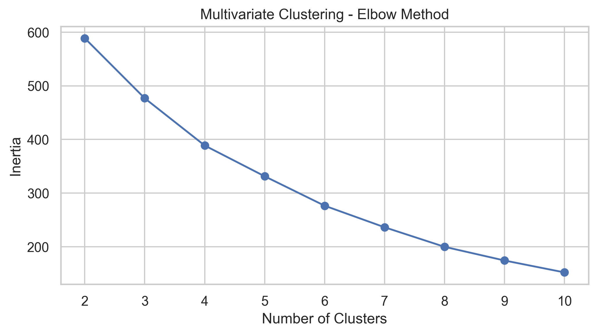
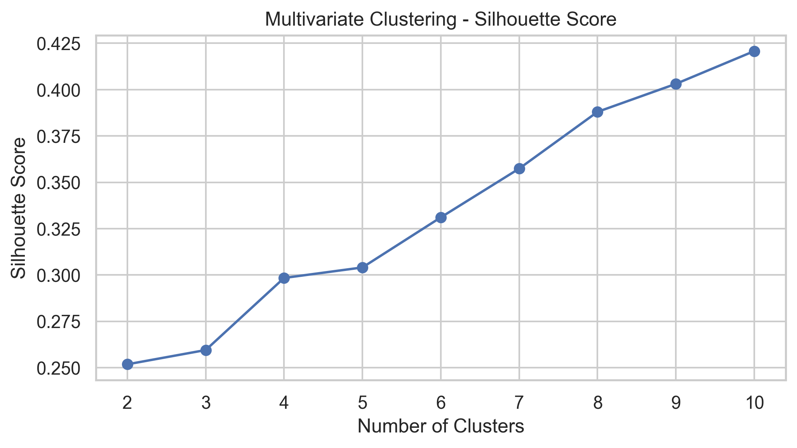
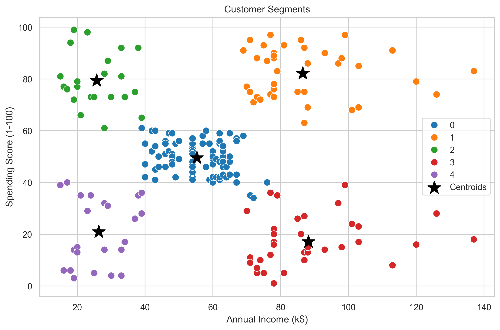

# Mall Customer Segmentation Using K-Means Clustering

## Project Overview

This project focuses on analyzing mall customer data and identifying different customer segments using Python and unsupervised machine learning.

K-Means clustering is applied to group customers based on their age, annual income, and spending score.

## Project Objectives

- Understand customer demographics and spending behaviour.
- Perform Exploratory Data Analysis (EDA).
- Apply K-Means clustering to segment customers.
- Identify suitable clusters using the Elbow Method.
- Evaluate clustering performance using the Silhouette Score.
- Generate business insights for targeted marketing strategies.

## Problem Statement

The objective of this project is to analyze mall customer data and identify distinct customer segments using Python and unsupervised machine learning.

By analyzing customer demographics, annual income, and spending scores, the project applies K-Means clustering to group customers with similar characteristics and spending behaviour.

The analysis aims to help businesses understand their customer base, identify high-value customer groups, and develop targeted marketing strategies to improve customer engagement and business performance.

## Dataset

**File:** `Mall_Customers.csv`

**Dataset Features:**
- CustomerID
- Gender
- Age
- Annual Income (k$)
- Spending Score (1-100)

## Technologies Used

- Python
- Pandas
- NumPy
- Matplotlib
- Seaborn
- Scikit-learn
- Jupyter Notebook

## Machine Learning Algorithm

**K-Means Clustering**

Methods Used:
- Univariate Clustering
- Bivariate Clustering
- Multivariate Clustering
- Elbow Method
- Silhouette Score
- StandardScaler

## Project Workflow

1. Data Loading
2. Data Exploration
3. Data Cleaning
4. Exploratory Data Analysis
5. Feature Selection
6. Data Scaling
7. K-Means Clustering
8. Cluster Evaluation
9. Customer Segmentation
10. Business Insights

## Project Visualizations

### 1. Elbow Method

The Elbow Method helps identify the optimal number of clusters by analyzing the Within-Cluster Sum of Squares (WCSS).



### 2. Silhouette Score

The Silhouette Score evaluates how well customers are grouped within their assigned clusters and how clearly separated the clusters are.



### 3. Customer Segmentation Clusters

Visual representation of customer groups identified using the K-Means clustering algorithm.



## Project Documentation

For detailed information about the problem statement, objectives, methodology, and project implementation, refer to:

[ Mall Customer Segmentation Project Documentation ](Mall_Customer_Segmentation_Project_Documentation.docx)

## Project Structure

```text
Mall-Customer-Segmentation/
│
├── images/
│   ├── elbow_method.png
│   ├── silhouette_score.png
│   └── customer_clusters.png
│
├── Customer_Segmentation_Analysis.ipynb
├── Mall_Customer_Segmentation_Project_Documentation.docx
├── Mall_Customers.csv
├── Mall_Customers_with_Clusters.csv
├── requirements.txt
└── README.md
```

## How to Run the Project

1. Clone this repository:

   ```bash
   git clone https://github.com/ajith-data/Mall-Customer-Segmentation.git
   ```

2. Navigate to the project directory.

3. Install the required libraries:

   ```bash
   pip install -r requirements.txt
   ```

4. Open Jupyter Notebook.

5. Run `Customer_Segmentation_Analysis.ipynb`.

6. Ensure the dataset is available in the same directory as the notebook.

## Author

**Ajith Baskaran**

GitHub: [ajith-data](https://github.com/ajith-data)
